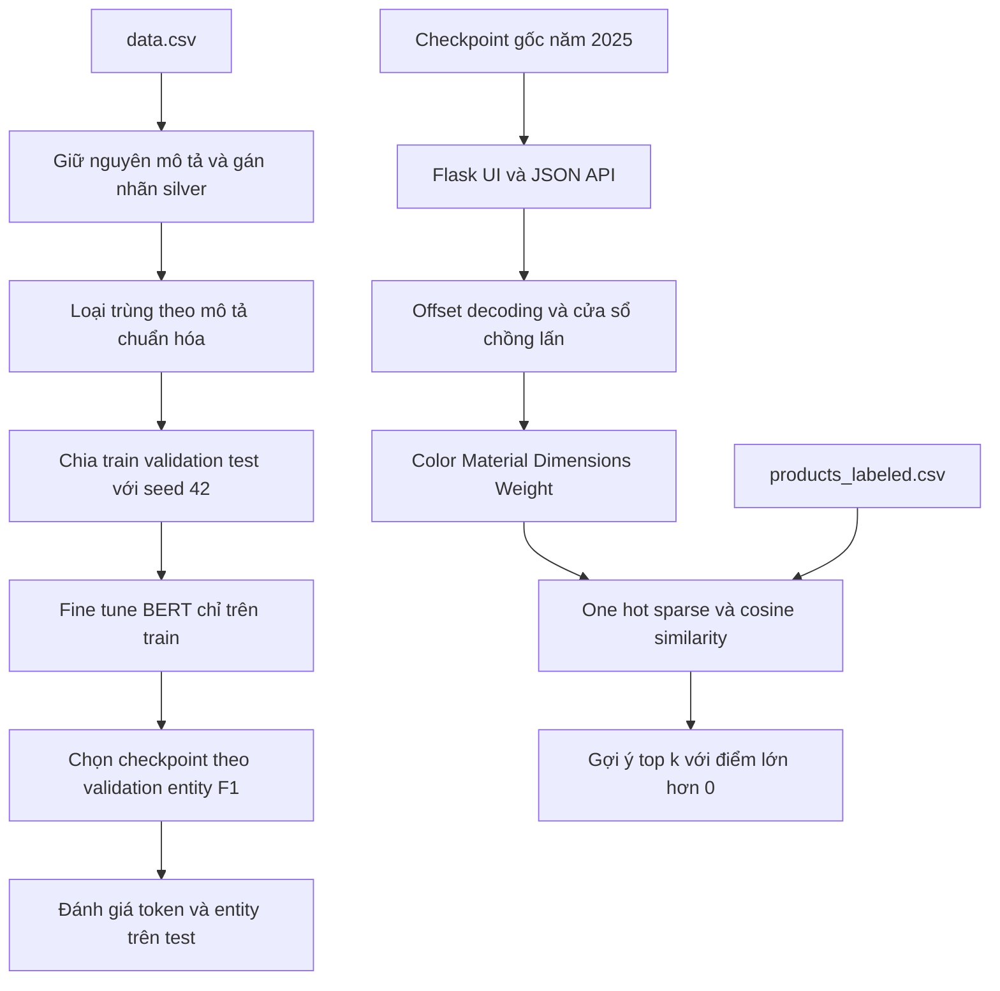

# Kiến trúc hệ thống

Nhánh train mới đã được bổ sung thành CLI và kiểm tra hai bước smoke. Checkpoint gốc vẫn là checkpoint của ứng dụng và phép đánh giá tái lập. Không có đường nối ngầm từ model cũ sang đánh giá test mới như một benchmark độc lập.

Ứng dụng dùng factory create_app để kiểm thử mà không cần mở server thật. Dịch vụ được khởi tạo lazy; khi người dùng gửi input đầu tiên, mô hình/tokenizer hoặc catalog được tải từ đường dẫn cấu hình. Inference chạy model.eval và torch.inference_mode. Một khóa bảo vệ việc load và một khóa bảo vệ inference cho cùng instance.

Mô tả dài được tokenize đầy đủ rồi chia thành cửa sổ 128 vị trí với 32 subword chồng lấn. Với offset xuất hiện ở nhiều cửa sổ, chọn nhãn có xác suất cao nhất; ghép entity theo offset gốc, không ghép chuỗi WordPiece bằng cách thêm dấu cách. Cách gộp xác suất này chưa được so sánh với những chiến lược khác.

Recommendation lưu ma trận sparse, chuẩn hóa chữ hoa/thường và khoảng trắng, bỏ đóng góp của giá trị thiếu. Unknown category được bỏ qua. Catalog có nhiều giá trị tổng hợp hoặc gán nhãn chưa tốt; exact one-hot matching không thay thế ontology, embedding retrieval hoặc phép đánh giá chất lượng gợi ý.
