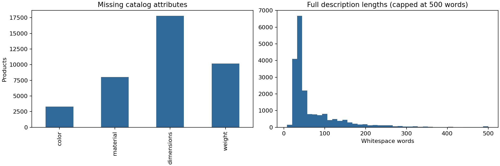
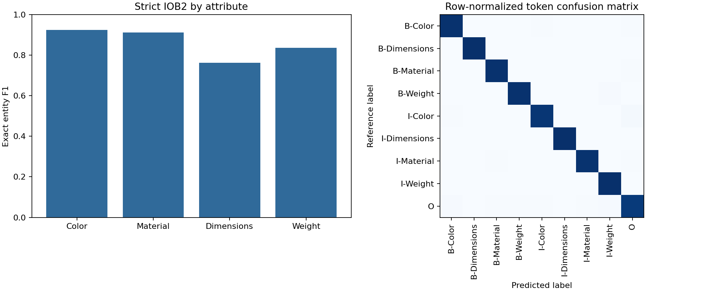

# Báo cáo kỹ thuật bổ sung đồ án trích xuất thuộc tính sản phẩm

Ứng viên: Dao Ngoc Binh Thien. Trường Đại học Đại Nam. Phần đồ án gốc hoàn thành năm 2025; phần hoàn thiện kỹ thuật và kiểm chứng dưới đây thực hiện ngày 12/10/2026. Tài liệu này bổ sung evidence cho repository và portfolio, không tự thay thế quy định hình thức hoặc xác nhận của trường.

## Mở đầu

Thông tin màu, vật liệu, kích thước và khối lượng nằm trong mô tả thương mại điện tử gây khó khăn cho tìm kiếm/lọc dữ liệu. Mục tiêu là xây dựng pipeline trích xuất bốn nhóm thuộc tính bằng BERT token classification, tích hợp vào Flask và hỗ trợ gợi ý sản phẩm theo thuộc tính. Dự án giới hạn ở văn bản tiếng Anh và prototype local; không đo doanh thu, conversion hoặc hiệu quả recommendation thực tế.

Lần hoàn thiện này tập trung vào ba vấn đề: khả năng chạy lại, phân biệt metric token/entity, và sửa các lỗi tích hợp ứng dụng. Kết quả là ứng dụng chạy với checkpoint local, bộ test chức năng, quy trình training/evaluation CLI và tài liệu dữ liệu/mô hình có nguồn gốc rõ.

## Chương 1 Cơ sở và phương pháp

BERT là encoder pretrained dùng biểu diễn ngữ cảnh hai chiều; nghiên cứu gốc là [Devlin et al. 2019](https://aclanthology.org/N19-1423/). Trong bài toán này, BertForTokenClassification tạo logits chín nhãn: B/I cho Color, Material, Dimensions, Weight và O. BIO mô tả vị trí bắt đầu/tiếp tục entity; tokenizer chia WordPiece nên nhãn cần align theo word_ids. Special tokens và padding nhận -100 để không đóng góp loss.

Notebook gốc dùng PyTorch, Hugging Face Transformers, AdamW 2e-5, batch 8, ba epoch và class-weighted cross-entropy. Model lưu cùng config map nhãn và tokenizer. Hàm focal loss và sampler có trong notebook nhưng không phải loss/sampler của run cuối; không nhận các thử nghiệm đó đã được so sánh nếu không có output.

Đánh giá token so sánh từng subword label. Weighted F1 bao gồm O và chịu ảnh hưởng class imbalance. Entity evaluation yêu cầu đúng loại và đầy đủ ranh giới; code bổ sung dùng strict IOB2 và không biến orphan I thành entity để tăng điểm. Phương pháp token classification có thể đối chiếu [tài liệu Hugging Face](https://huggingface.co/docs/transformers/tasks/token_classification).

## Chương 2 Dữ liệu và hệ thống

Raw CSV có 20.000 sản phẩm, hai dòng thiếu mô tả. Bộ gốc tạo 19.994 labeled sequences sau lọc/rút ngắn; train/validation/test lần lượt 13.995/2.999/3.000. Nhãn là silver từ rule và specifications. Việc xóa nhiều O tokens trước khi chia tập thay đổi câu và làm inference trên câu nguyên vẹn khác với điều kiện training/evaluation cũ.

Kiểm tra corpus phát hiện 1.807 mô tả không thiếu bị trùng. Pipeline mới giữ đủ text và O tokens, loại trùng theo normalized-description hash, tạo 18.191 mô tả unique với split 12.733/2.728/2.730 và seed 42. Manifest lưu SHA256 raw CSV, split unit và nguồn nhãn. Đây là corpus chuẩn bị cho training mới; checkpoint cũ chưa được retrain trên corpus này. Theo [khuyến nghị scikit-learn về data leakage](https://scikit-learn.org/stable/common_pitfalls.html), class weights tính từ train và test không được dùng chọn checkpoint.

Ứng dụng được refactor thành create_app, dùng đường dẫn theo project hoặc environment, model.eval và inference_mode. Decode dựa vào offset của text gốc để giữ nguyên từ/đơn vị. Mô tả dài dùng cửa sổ 128 vị trí chồng lấn 32 subword; kiểm thử xác minh xử lý tới ký tự cuối, thay vì giả định return_overflowing_tokens hoạt động giống nhau ở mọi phiên bản tokenizer.

Flask cung cấp UI và JSON endpoints /api/extract, /api/recommend, /health. Input sai trả 400, body quá lớn 413, service không có model/catalog trả 503. Hai form được tách để HTML required của extraction không chặn recommendation. Chỉ chạy local, không bật debug, không nhận đây là triển khai production.

Recommendation dùng OneHotEncoder sparse và cosine similarity trên bốn thuộc tính. Missing categories không đóng góp similarity; unknown categories được bỏ qua, không trả sản phẩm có điểm 0; loại mô tả trùng trong top-k. Đây là exact attribute matching, không phải BERT embedding retrieval. Dữ liệu catalog còn noisy và chưa có relevance judgments để đo Precision@K/NDCG.

## Chương 3 Thực nghiệm và kết quả

Ngày chạy lại: 12/10/2026. Môi trường Windows, Python 3.13.2, PyTorch 2.6 CPU, Transformers 5.18.0. File requirements và audit ghi package versions/hashes. GPU trên máy không được dùng vì PyTorch hiện tại là CPU build.

Đã chạy checkpoint gốc trên toàn bộ 3.000 test sequences của split lịch sử. Có 67.494 subword label positions được đánh giá. Weighted token F1 tái lập 0.965502, khớp output notebook gốc. Strict exact-entity micro F1 0.907216 và macro F1 0.858847. Entity micro precision 0.851785, recall 0.970365: recall cao nhưng còn entity thừa/sai ranh giới. Các con số không phải human-gold performance trên mô tả nguyên vẹn.

| Attribute | Precision | Recall | F1 | Entity support |
| --- | ---: | ---: | ---: | ---: |
| Color | 0.8803 | 0.9733 | 0.9244 | 3890 |
| Material | 0.8663 | 0.9633 | 0.9122 | 2482 |
| Dimensions | 0.6203 | 0.9899 | 0.7626 | 99 |
| Weight | 0.7314 | 0.9758 | 0.8361 | 784 |

Dimensions có support nhỏ và precision thấp nhất; Weight cũng có nhiều false positives. Điều này quan trọng hơn việc chỉ nêu điểm tổng hợp. Danh sách prediction/error đầy đủ nằm trong artifacts/legacy-evaluation/predictions.jsonl.

| Model trên cùng historical silver split | Weighted token F1 | Entity micro F1 |
| --- | ---: | ---: |
| BERT checkpoint gốc | 0.965502 | 0.907216 |
| Rule baseline được chạy lại | 0.920067 | 0.765786 |

Baseline có chung một phần rules với labeler nên so sánh chỉ chứng minh kết quả trong protocol này. Không có evidence thực nghiệm cho các baseline CRF/BiLSTM-CRF/TextCNN được đề cập trong bản báo cáo cũ; không đưa con số đó vào bảng mới.

Kiểm thử: 20 tests passed, không skip trong run có RUN_MODEL_TESTS=1. Phạm vi bao gồm decode WordPiece/offset, entity boundary, giữ context và dedup splits, API validation, form độc lập, HTML escaping, unknown/missing categories, duplicate recommendations và real-checkpoint inference trên mô tả dài. Factory tests dùng mock để cô lập chức năng; integration test và service_smoke dùng checkpoint thật. Service smoke cũng chạy catalog 20.000 rows với query known color và kiểm tra status/recommendations.

Training CLI được chạy smoke continuation hai optimizer steps, validation tám ví dụ và lưu checkpoint riêng. Kết quả smoke không được trình bày như một nghiên cứu hoặc dùng làm CV metric. Checkpoint gốc và notebook không bị thay đổi.

## Hạn chế và nghiên cứu tiếp theo

Historical silver labels có duplicate overlap, orphan I và ngữ cảnh đã rút ngắn. Test mới còn có thể overlap kiến thức của model cũ. Chưa có tập gold được người đánh giá độc lập xác minh. Tham số confidence chưa calibration; sliding-window aggregation chưa ablation. Recommendation chưa có relevance labels hoặc feedback thật. Không xác nhận nguồn dữ liệu upstream byte-for-byte hoặc quyền phân phối lại file local.

Đã xuất 50 annotation candidates và hướng dẫn gán nhãn. Cần review mù trước khi gọi là gold, train checkpoint mới từ pretrained base với split mới và đánh giá nhiều seed. Bộ docs không tự tạo sự đồng ý của giảng viên, chữ ký, xác nhận học thuật hoặc thành tích chưa thực hiện.

## Kết luận

Repository đã có ứng dụng chạy được, dependency specification, data preparation không xóa context, reproducible training/evaluation, baseline thật, EDA có output, tests và tài liệu hệ thống. Điểm weighted token F1 96.55% của run cũ được tái lập; entity metric và hạn chế được tách rõ. CV chỉ bổ sung những phần đã được triển khai và kiểm thử, không nhận gold evaluation, full retraining hoặc production deployment.

## Tài liệu tham khảo

1. Devlin, Chang, Lee, Toutanova. BERT Pre-training of Deep Bidirectional Transformers for Language Understanding. NAACL 2019. https://aclanthology.org/N19-1423/
2. Hugging Face. Token classification tutorial. https://huggingface.co/docs/transformers/tasks/token_classification
3. scikit-learn. Common pitfalls and recommended practices. https://scikit-learn.org/stable/common_pitfalls.html
4. PromptCloud. Flipkart Products dataset page. https://www.kaggle.com/PromptCloudHQ/flipkart-products/code

Tài liệu bổ trợ: DATA_CARD.md, MODEL_CARD.md, ARCHITECTURE.md, EVALUATION_PROTOCOL.md, REPORT_CORRECTIONS.md và DEFENSE_GUIDE.md.
